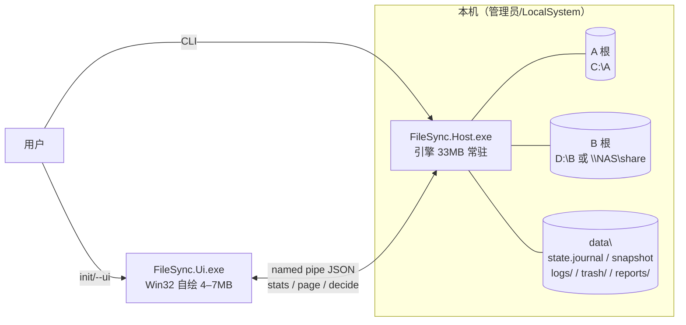
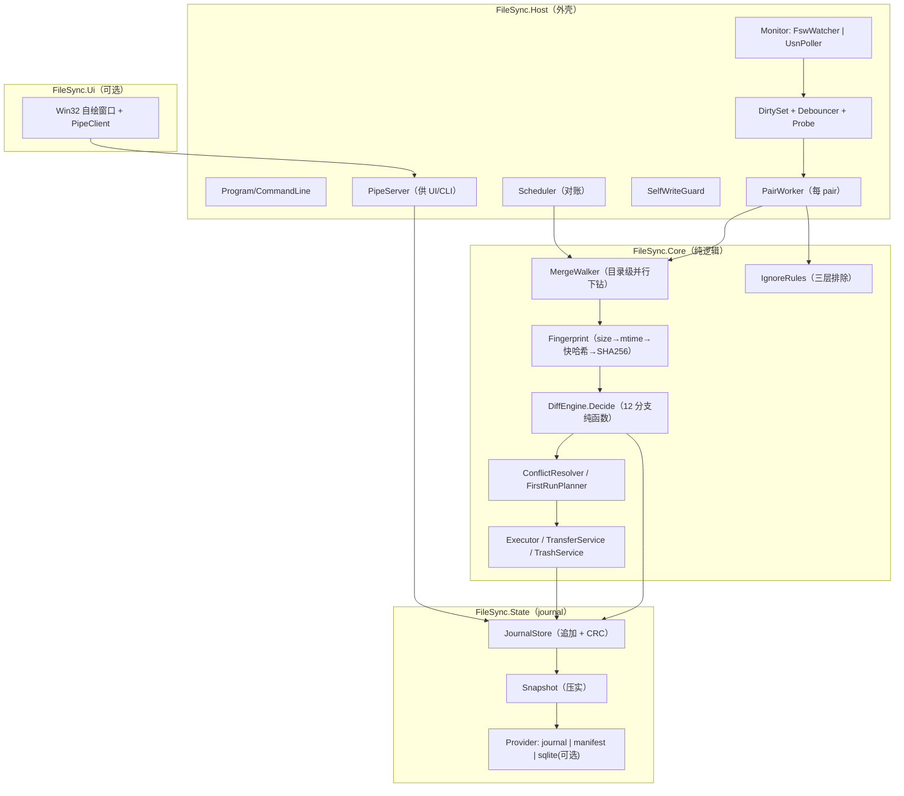
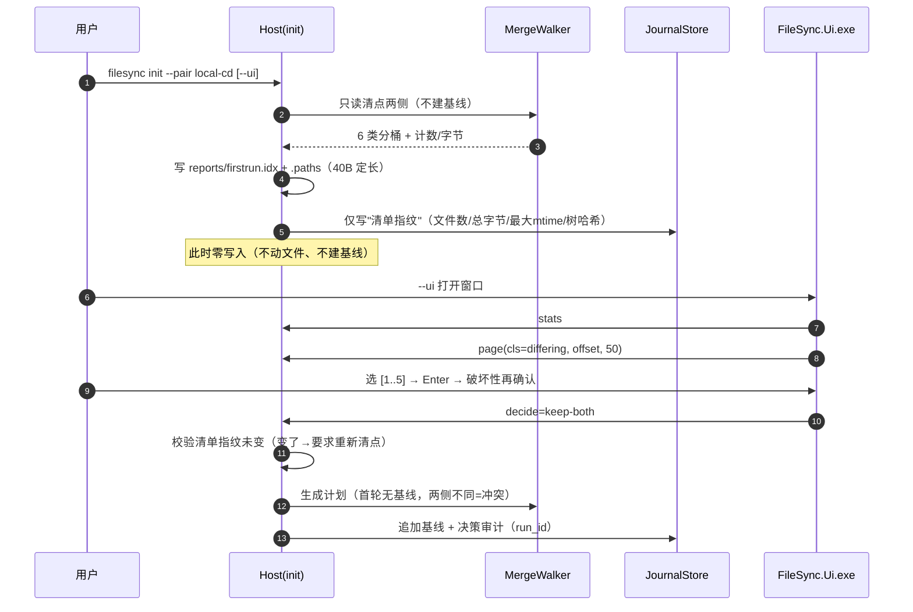
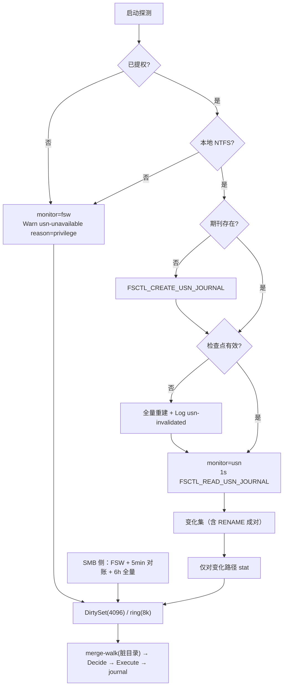
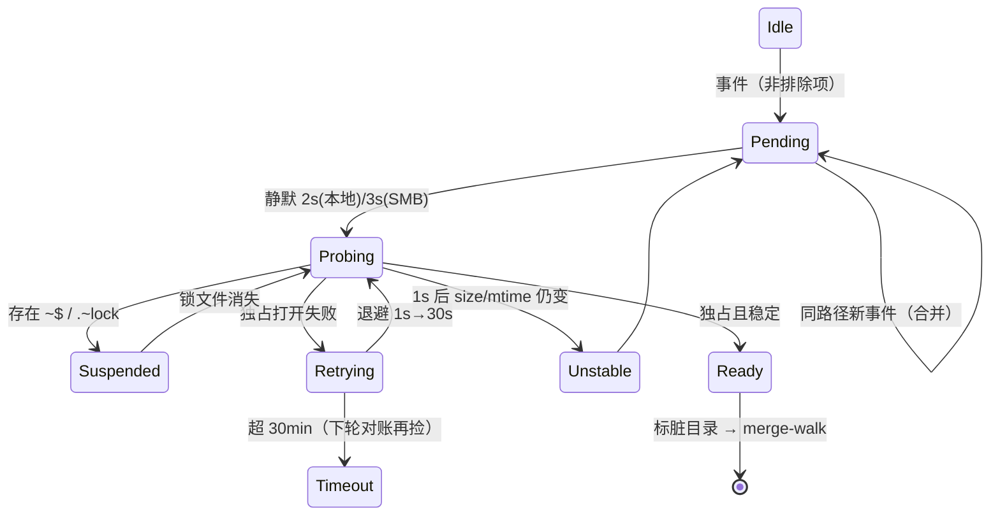
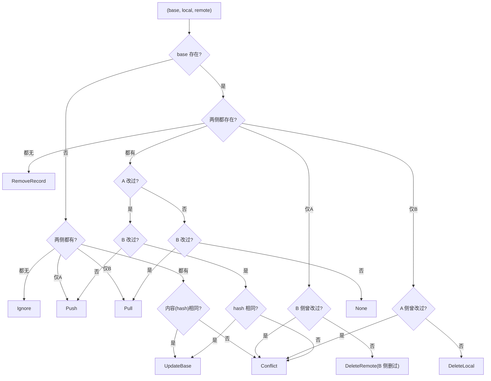
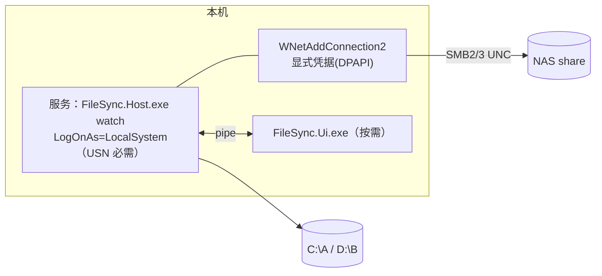

# 骨架图｜FileSync（对应当前定稿：pair + merge-walk + journal + USN + 自绘 UI）

> 已定决策：允许管理员运行（USN 启用）、状态后端 `journal`（无 SQLite）、`diff.mode=merge`、UI 为独立自绘 exe（4–7MB）。
> 本文取代旧版骨架图中的 SQLite / 全量清单 / 单 watcher 相关图示。
> 配套：`docs/PRD.md`、`docs/监控设计.md`、`docs/优化方案-USN与内存.md`、`docs/变体方案-无SQLite与本地双盘.md`、`docs/UI方案-自绘低内存.md`。

---

## 1. 系统上下文（含 UI 进程）



约束：`data\` 必须**不落在任何 root 内**（否则自己同步自己），启动时校验。

---

## 2. 进程与线程骨架

```
FileSync.Host.exe（引擎，稳态 ≈33MB）
│
├── [T1 主线程]        配置/校验 → 生命周期 → 优雅关闭
├── [T2..Tn 监听器]    每个 pair 每侧一个：
│                       A 侧: FSW + USN 轮询(1s)   B 侧: FSW (+USN 若本地 NTFS)
│                       → 只产出「脏目录」提示，不做 IO
├── [T3 合并器]         dirtyDirs(4096) + dirtyPaths(8k ring)
│                       同目录多次 → 1 条；溢出 → NeedFullRescan
├── [T4 调度器]         对账：本地 60min / SMB 5min 增量；6h 全量校验
├── [T5 Worker(每 pair 1个)]  merge-walk(脏目录) → Decide() → Execute
│                       传输并发 ≤2，单缓冲 256KB
└── [T6 日志/自检]       journal 压实、日志滚动、内存守卫、status 聚合

FileSync.Ui.exe（可选，用完即退）
└── [U1 消息循环] WM_PAINT 逐行直绘 → GDI；只持当前页 ≤50 行；无框架
```

单一 journal 写者（T5 或 T3 串行提交），避免并发写坏状态。

---

## 3. 分层与依赖方向



---

## 4. 目录/类型骨架

```
E:\code\filesync\
├─ FileSync.sln
├─ Directory.Build.props           net8.0 / nullable / InvariantGlobalization / ServerGC=false
├─ docs\                           （7 份文档，见 §13）
├─ src\
│   ├─ FileSync.Core\
│   │   ├─ Models\      FileEntry.cs  SyncAction.cs  ActionKind.cs  RootProfile.cs
│   │   ├─ Walk\        MergeWalker.cs  DirEnumerator.cs  RenameIndex.cs(有上限)
│   │   ├─ Scanning\    Fingerprint.cs  IgnoreRules.cs  PathKey.cs
│   │   ├─ Diff\        DiffEngine.cs  ConflictResolver.cs  FirstRunPlanner.cs
│   │   └─ Execution\   Executor.cs  TransferService.cs  TrashService.cs  RetryPolicy.cs
│   ├─ FileSync.State\
│   │   ├─ JournalStore.cs  JournalRecord.cs  Snapshot.cs  Compactor.cs
│   │   └─ Providers\   JournalProvider.cs  ManifestProvider.cs  SqliteProvider.cs(可选)
│   ├─ FileSync.Host\
│   │   ├─ Program.cs  CommandLine.cs  SyncConfig.cs  PairWorker.cs
│   │   ├─ Monitor\     FswWatcher.cs  UsnPoller.cs  NativeUsn.cs  DirtySet.cs
│   │   ├─ Stability\   Debouncer.cs  Probe.cs  SelfWriteGuard.cs
│   │   ├─ FirstRun\    InventoryWriter.cs  InitCommand.cs
│   │   └─ Ipc\         PipeServer.cs  Protocol.cs
│   └─ FileSync.Ui\     Program.cs  Win32.cs  Painter.cs  Viewport.cs  PipeClient.cs
└─ tests\
    ├─ FileSync.Core.Tests\        DiffMatrixTests.cs  MergeWalkerTests.cs  IgnoreRulesTests.cs
    └─ FileSync.Integration.Tests\ PairSyncTests.cs  CrashRecoveryTests.cs  FirstRunTests.cs
```

| 关键类型 | 职责 | 签名 |
|---|---|---|
| `MergeWalker` | A/B 同名目录并行下钻，逐目录产出动作 | `IAsyncEnumerable<SyncAction> Walk(string a, string b, CancellationToken)` |
| `UsnPoller` | 读 USN 增量 → 脏目录集合 | `Task PollOnceAsync(CancellationToken)` |
| `DirtySet` | 有界去重（4096 目录 / 8k 路径） | `bool TryAdd(dir)` / `bool Overflowed` |
| `Probe` | "能不能读干净" | `bool IsQuiescent(path, out reason)` |
| `DiffEngine.Decide` | 12 分支判定（纯函数） | `ActionKind Decide(FileEntry? l, FileEntry? r, Baseline? b)` |
| `FirstRunPlanner` | 首次清点 → 6 类分桶 + 决策转动作 | `FirstRunReport Analyze(...)` / `SyncPlan Apply(Choice c)` |
| `JournalStore` | 追加记录 + CRC + 尾部截断 | `Append(record)` / `TryGet(rel, out Baseline)` / `Compact()` |
| `TransferService` | 流式复制 + 哈希 + 原子落盘 | `string CopyWithHash(src,dst,buf)` |

---

## 5. 数据流：一轮同步（merge-walk）

```
事件/对账 ──► 脏目录集合（有界）
                     │
                     ▼
        ① 稳定化闸门：ignore → ~$ 锁 → 独占探测 → 1s 复核
                     │ 通过
                     ▼
        ② merge-walk(单个目录)：两侧流式枚举，逐条 Decide(l, r, base)
                     │  动作：Push / Pull / Move / MoveDir / Delete / Conflict / None
                     ▼
        ③ 执行顺序：建目录(浅→深) → 改名 → 传输 → 删除(深→浅) → 顺序在"目录删除展开"后
                     │
                     ▼
        ④ journal 追加一条：基线 + 日志（同一记录，原子）
                     │
                     ▼
        ⑤ 递归子目录（内存只随"单目录宽度"增长）
```

删除与目录规则（防止丢数据）：

| 情形 | 规则 |
|---|---|
| 文件删除 | 扫描确认该侧不存在 + 阈值保护 → 目标端进 trash（不直删） |
| **目录删除** | **必须展开为逐条决策**：目标端该子树内若有"相对基线变过"的文件 → 逐个 Conflict/保留，绝不整树删除 |
| **目录改名** | 作为一等动作 `MoveDir`（USN 的 RENAME 成对记录提供 FRN）；目标端同卷 rename，**不整树重传** |

---

## 6. 首次同步流程（新增）



---

## 7. 监控分层（USN 优先 / FSW 降级 / SMB 只能 FSW）



**顺序铁律（v1 骨架图的错误已修正）**：先把"脏目录待办"追加进 journal（fsync），**再**推进 `nextUsn`。
反过来（先推进 USN 后处理）在崩溃时会永久丢事件。

```sql
-- journal 记录类型（不是 SQLite 表，仅示意字段）
record UsnCheckpoint(volId, journalId, nextUsn, updatedAt)
record DirtyTodo      (side, dirRel, reason, ts)        -- 崩溃后重放用
record Baseline       (rel, kind, size, mtimeA, mtimeB, hash8, hash32?, op, ts)
record LogEntry       (ts, level, op, rel, bytes, durationMs, runId, msg)
record Inflight       (rel, direction, tempPath, startedAt)
record ConflictNote   (rel, conflictPath, side, ts)
record InitDecision   (pair, choice, fingerprint, ts, runId)
```

---

## 8. 实时事件状态机（"编辑完成"判定）



---

## 9. 判定矩阵（12 分支）



冲突坐实条件：`localChanged && remoteChanged && SHA256(l) != SHA256(r)`；元数据差异不算冲突。

---

## 10. 状态存储（journal，无 SQLite）

```
data\
├─ state.snapshot        # 定长记录 + 路径 arena，压实后原子 rename
├─ state.journal         # [u32 len][u32 crc][payload] 追加；尾部损坏即截断
├─ logs\fs-YYYYMMDD.jsonl
├─ trash\<pair>\<ts>\...
└─ reports\firstrun.idx  + firstrun.paths
```

```
追加 → fsync → 更新内存索引（10万条目 ≈ 69B/条 ≈ 7MB）
重放 = snapshot + journal 尾；journal > 2×snapshot 或 > 4MB → Compact()
崩溃：读到 CRC 不符即截断（等价于"最后一次成功提交"）
```

| 关注点 | journal | （可选）sqlite |
|---|---|---|
| 依赖 | 纯托管，+0 | +1.3MB native |
| 日志检索 | JSONL + `logs` 子命令 | SQL |
| 启动 | 0.3–1s（10万条） | ~10ms |

---

## 11. 内存与并发预算（实测口径）

```
稳态（USN 轮询 1s/次 + 60min 对账）        峰值（复制 1GB）
┌──────────────────────────────┐          ┌──────────────────────────────┐
│ .NET 运行时地板        27.8M │          │ 运行时地板             27.8M │
│ journal 内存索引(10万)    ~7M │          │ 索引                    ~7M │
│ merge-walk 单目录      0.15M │          │ merge-walk 单目录      0.15M │
│ 复制缓冲(256KB×1)      0.25M │          │ 复制缓冲               0.25M │
│ 事件 ring(8k)            ~1M │          │ ring                     ~1M │
│ 余量                     ~3M │          │ 余量                     ~3M │
└──────────────────────────────┘          └──────────────────────────────┘
                         合计 ≈ 39M                                  ≈ 39M
硬限：GCHeapHardLimit=96MB；目标：稳态 <40MB / 峰值 <50MB，与文件数无关
UI（独立进程，可选）：4–7MB，关闭即释放
```

---

## 12. 部署骨架



```powershell
# 以 LocalSystem 运行（USN 需要）；NAS 凭据用显式连接，不依赖用户会话映射
sc.exe create FileSync binPath= "C:\Filesync\FileSync.Host.exe watch" start= auto obj= "LocalSystem"
```

> 修订：旧文档建议"LogOnAs 有 NAS 凭据的用户账户"，与 USN 的提权要求冲突；现统一为 **LocalSystem + 显式 SMB 凭据**。

---

## 13. 文档地图（避免读到过时内容）

| 文档 | 状态 | 说明 |
|---|---|---|
| `PRD.md` | 现行（需求唯一来源） | 含 FR-1.5~1.9、FR-2.7~2.11、FR-5.5/5.6、FR-10 UI |
| `监控设计.md` | 现行（监控定稿） | USN/FSW/对账、稳定化、失效降级 |
| `优化方案-USN与内存.md` | 现行（v2 依据） | 实测数据、merge-walk 预算 |
| `变体方案-无SQLite与本地双盘.md` | 现行 | state provider、本地双盘、能力档案 |
| `UI方案-自绘低内存.md` | 现行 | Win32 自绘、虚拟列表、mmap 分页 |
| `骨架图.md`（本文） | 现行（图示） | 已同步全部决策 |
| `技术方案.md` | **v1 基线（部分已被取代）** | SQLite/全量清单/仅 FSW 的章节仅作历史参考，按 §13 索引以本文为准 |
